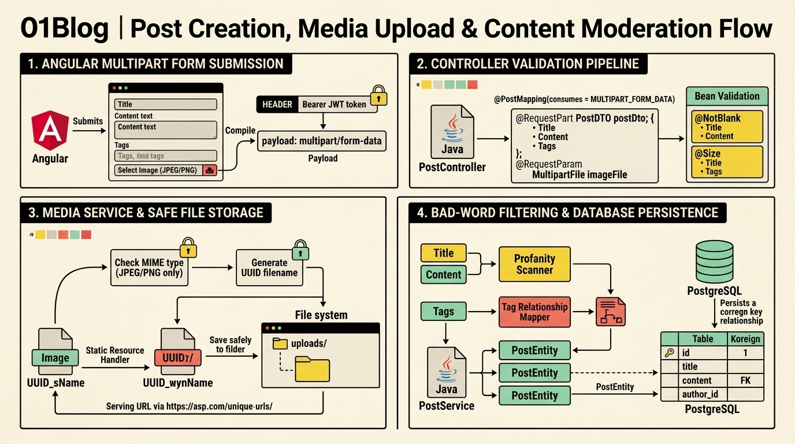
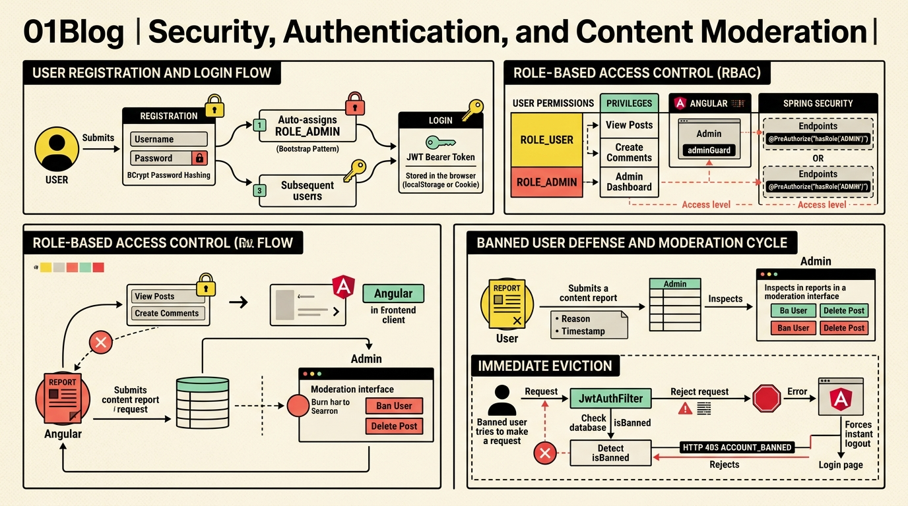

# 🌐 01Blog Request Flows Encyclopedia
## The Complete End-to-End Architectural Highway for Every Request in the Platform


> **Zone01 Peer Evaluation Defense Reference:**  
> This master encyclopedia documents the exact chronological journey of the HTTP endpoints across all Controllers in the 01Blog platform.  
> Every request flow is analyzed through the **4-Phase Deep Dive**:
> 1. **Phase 1: Network & Controller Boundary** (Linux TCP Sockets, Tomcat worker thread pool, Spring Security filters, `ThreadLocal` context, and `DispatcherServlet` routing).
> 2. **Phase 2: Inside Service & Persistence Layer** (Spring `@Transactional` boundaries, Hibernate ORM 6 Persistence Context / L1 Cache, Entity Lifecycle states in JVM Heap, and PostgreSQL 16 Wire Protocol 3.0 queries over Port 5432).
> 3. **Phase 3: Business Logic & DTO Construction** (Security invariants, Dirty Checking snapshot diffing, Byte Buddy lazy proxies, and safe DTO mapping via `.fromEntity()`).
> 4. **Phase 4: Teardown, Exception Handling & JSON Delivery** (Commit/Flush, session teardown, Jackson JSON ASCII serialization, and HTTP status codes).

---

# 📑 Master Flow Directory

- [The Universal Request Highway (The 7-Step Relay Race)](#the-universal-request-highway-the-7-step-relay-race)
- [Domain 1: Authentication & Identity Flows (`AuthController`)](#domain-1-authentication--identity-flows-authcontroller)
  - [Flow 1: User Registration (`POST /api/auth/register`)](#flow-1-user-registration-post-apiauthregister)
  - [Flow 2: User Login (`POST /api/auth/login`)](#flow-2-user-login-post-apiauthlogin)
- [Domain 2: Post Lifecycle & Media Operations (`PostController`)](#domain-2-post-lifecycle--media-operations-postcontroller)
  - [Flow 3: Publishing a Post with Media (`POST /api/posts`)](#flow-3-publishing-a-post-with-media-post-apiposts)
  - [Flow 4: Fetching Public Global Feed (`GET /api/posts`)](#flow-4-fetching-public-global-feed-get-apiposts)
  - [Flow 5: Inspecting a Single Post (`GET /api/posts/{id}`)](#flow-5-inspecting-a-single-post-get-apipostsid)
  - [Flow 6: Fetching Subscribed Friends Feed (`GET /api/posts/feed`) & N+1 Prevention](#flow-6-fetching-subscribed-friends-feed-get-apipostsfeed--n1-prevention)
  - [Flow 7: Fetching Author's Profile Posts (`GET /api/posts/user/{username}`)](#flow-7-fetching-authors-profile-posts-get-apipostsuserusername)
  - [Flow 8: Updating Post Content & Media (`PUT /api/posts/{id}`) via Dirty Checking](#flow-8-updating-post-content--media-put-apipostsid-via-dirty-checking)
  - [Flow 9: Deleting a Post with Cascade Cleanups (`DELETE /api/posts/{id}`)](#flow-9-deleting-a-post-with-cascade-cleanups-delete-apipostsid)
- [Domain 3: Social Interactions & Subscriptions (`PostController` & `UserController`)](#domain-3-social-interactions--subscriptions-postcontroller--usercontroller)
  - [Flow 10: Toggle Like on Post (`POST /api/posts/{id}/like`) & Concurrency Defense](#flow-10-toggle-like-on-post-post-apipostsidlike--concurrency-defense)
  - [Flow 11: Inspect Like Status (`GET /api/posts/{id}/like`)](#flow-11-inspect-like-status-get-apipostsidlike)
  - [Flow 12: Follow/Subscribe to Student (`POST /api/users/{username}/follow`) via Join Table](#flow-12-followsubscribe-to-student-post-apiusersusernamefollow-via-join-table)
  - [Flow 13: Unfollow/Unsubscribe from Student (`POST /api/users/{username}/unfollow`)](#flow-13-unfollowunsubscribe-from-student-post-apiusersusernameunfollow)
- [Domain 4: Comment Threading Flows (`CommentController`)](#domain-4-comment-threading-flows-commentcontroller)
  - [Flow 14: Adding a Comment (`POST /api/posts/{postId}/comments`)](#flow-14-adding-a-comment-post-apipostspostidcomments)
  - [Flow 15: Fetching Post Comments (`GET /api/posts/{postId}/comments`)](#flow-15-fetching-post-comments-get-apipostspostidcomments)
  - [Flow 16: Deleting a Comment (`DELETE /api/posts/{postId}/comments/{commentId}`) & Triple-Layer Guard](#flow-16-deleting-a-comment-delete-apipostspostidcommentscommentid--triple-layer-guard)
- [Domain 5: User Profiles & Avatar Management (`UserController`)](#domain-5-user-profiles--avatar-management-usercontroller)
  - [Flow 17: Fetch Current User Identity (`GET /api/users/me`)](#flow-17-fetch-current-user-identity-get-apiusersme)
  - [Flow 18: Inspect Student Profile Card (`GET /api/users/{username}`)](#flow-18-inspect-student-profile-card-get-apiusersusername)
  - [Flow 19: Search Students by Username (`GET /api/users/search`)](#flow-19-search-students-by-username-get-apiuserssearch)
  - [Flow 20: Upload Custom Brutalist Avatar (`POST /api/users/me/avatar`)](#flow-20-upload-custom-brutalist-avatar-post-apiusersmeavatar)
  - [Flow 21: Select Preset Avatar (`PUT /api/users/me/avatar/preset`)](#flow-21-select-preset-avatar-put-apiusersmeavatarpreset)
- [Domain 6: Notifications & Activity Alerts (`NotificationController`)](#domain-6-notifications--activity-alerts-notificationcontroller)
  - [Flow 22: Fetch Student Notifications (`GET /api/notifications`)](#flow-22-fetch-student-notifications-get-apinotifications)
  - [Flow 23: Unread Notification Badge Counter (`GET /api/notifications/unread-count`)](#flow-23-unread-notification-badge-counter-get-apinotificationsunread-count)
  - [Flow 24: Mark All Notifications Read (`PUT /api/notifications/read-all`)](#flow-24-mark-all-notifications-read-put-apinotificationsread-all)
- [Domain 7: Moderation, Reports & Admin Dashboard (`ReportController` & `AdminController`)](#domain-7-moderation-reports--admin-dashboard-reportcontroller--admincontroller)
  - [Flow 25: Submit Content/Profile Report (`POST /api/reports`)](#flow-25-submit-contentprofile-report-post-apireports)
  - [Flow 26: Fetch Admin Analytics Overview (`GET /api/admin/stats`) & Method Security Proxy](#flow-26-fetch-admin-analytics-overview-get-apiadminstats--method-security-proxy)
  - [Flow 27: List All Moderation Reports (`GET /api/admin/reports`)](#flow-27-list-all-moderation-reports-get-apiadminreports)
  - [Flow 28: Dismiss/Resolve Moderation Report (`DELETE /api/admin/reports/{id}`)](#flow-28-dismissresolve-moderation-report-delete-apiadminreportsid)
  - [Flow 29: List All Platform Users (`GET /api/admin/users`)](#flow-29-list-all-platform-users-get-apiadminusers)
  - [Flow 30: Toggle User Account Ban (`PUT /api/admin/users/{id}/ban`) & Runtime Lockdown Ripple](#flow-30-toggle-user-account-ban-put-apiadminusersidban--runtime-lockdown-ripple)
  - [Flow 31: Hard Administrative User Deletion (`DELETE /api/admin/users/{id}`)](#flow-31-hard-administrative-user-deletion-delete-apiadminusersid)
  - [Flow 32: Soft-Moderation Hide Post (`PUT /api/admin/posts/{id}/hide`)](#flow-32-soft-moderation-hide-post-put-apiadminpostsidhide)
  - [Flow 33: Hard Administrative Post Deletion (`DELETE /api/admin/posts/{id}`)](#flow-33-hard-administrative-post-deletion-delete-apiadminpostsid)

---

# The Universal Request Highway (The 7-Step Relay Race)

Every HTTP request that reaches 01Blog follows an immutable, chronological path through the operating system and JVM memory:

```
[ STEP 1: Angular Client & OS Socket ]
  - Browser executes Angular HttpClient call (e.g. GET /api/posts/10)
  - OS Kernel routes TCP packet to 127.0.0.1:8080
              |
              v
[ STEP 2: Embedded Tomcat & Worker Thread ]
  - Tomcat accept-thread dequeues TCP socket, assigns worker thread (e.g. http-nio-8080-exec-1)
  - Parses ASCII byte stream into HttpServletRequest & HttpServletResponse
              |
              v
[ STEP 3: Security Filter Gauntlet (VirtualFilterChain) ]
  - RateLimitFilter: In-memory IP bucket token check
  - SecurityContextHolderFilter: Clears/initializes ThreadLocal
  - CorsFilter: Validates Origin header against Angular port 4200
  - JwtAuthFilter: Parses "Bearer <token>", verifies HMAC-SHA256, loads User, checks !banned
  - SecurityContextHolder: Stores UsernamePasswordAuthenticationToken in ThreadLocal
              |
              v
[ STEP 4: DispatcherServlet & Spring MVC Routing ]
  - DispatcherServlet.doDispatch() executes
  - HandlerMapping O(1) hash map discovers matching @RestController method
  - HandlerAdapter resolves arguments (@PathVariable, @RequestBody, Authentication)
              |
              v
[ STEP 5: Service Layer & Transaction Boundary ]
  - Spring AOP wraps execution in TransactionInterceptor (@Transactional)
  - HikariCP pool allocates physical database connection to PostgreSQL on port 5432
  - Hibernate EntityManager initializes Persistence Context (L1 Cache) in RAM Heap
              |
              v
[ STEP 6: Persistence Layer & PostgreSQL 16 ]
  - Spring Data JpaRepository Dynamic Proxy translates method to SQL query
  - PostgreSQL Wire Protocol 3.0 packets travel across TCP socket localhost:5432
  - PostgreSQL executes query against 8KB disk pages / B-Tree indices
  - Hibernate inflates Managed Entities + Byte Buddy Lazy Proxies in RAM
  - Business logic executes; Dirty Checking snapshot diffing runs on commit
              |
              v
[ STEP 7: DTO Transformation & JSON Delivery ]
  - Service maps Managed Entities into flat, decoupled DTOs (e.g. PostResponse.fromEntity)
  - Transaction commits; Hibernate Session closes; entities become Detached
  - Controller returns ResponseEntity<DTO>
  - Jackson ObjectMapper serializes DTO fields into JSON ASCII bytes
  - Tomcat flushes HTTP 200/201/204 response across socket to Angular
  - SecurityContextHolder.clearContext() rips off thread sticker to prevent memory leaks
```

---

# Domain 1: Authentication & Identity Flows (`AuthController`)


### Flow 1: User Registration (`POST /api/auth/register`)
* **Endpoint:** `POST /api/auth/register`
* **Controller:** [`AuthController.java`](backend/src/main/java/com/zone01/blog/controller/AuthController.java#L26)
* **Service:** [`AuthService.java`](backend/src/main/java/com/zone01/blog/service/AuthService.java#L45)
* **Input DTO:** [`RegisterRequest.java`](backend/src/main/java/com/zone01/blog/dto/RegisterRequest.java) (`{ username, email, password }`)
* **Output DTO:** [`AuthResponse.java`](backend/src/main/java/com/zone01/blog/dto/AuthResponse.java) (`{ token, username, role, avatarUrl }`)

#### Phase 1: Network & Controller Boundary
* **At 0.0ms:** Angular client sends raw HTTP payload:
  ```http
  POST /api/auth/register HTTP/1.1
  Host: localhost:8080
  Content-Type: application/json
  Content-Length: 78

  {"username":"youssef","email":"youssef@zone01.com","password":"SuperSecret123"}
  ```
* **At 0.3ms:** Tomcat worker thread `http-nio-8080-exec-1` reads bytes.
* **At 0.6ms:** Enters `SecurityFilterChain`. The URL `/api/auth/**` matches `.permitAll()`. `JwtAuthFilter` does nothing.
* **At 0.9ms:** `DispatcherServlet` routes to `AuthController.register(@RequestBody RegisterRequest request)`. Jackson parses JSON into a heap-allocated `RegisterRequest` DTO object.

#### Phase 2: Inside Service & Persistence Layer
* **At 1.2ms:** Call enters `AuthService.register(request)` annotated with `@Transactional`.
* **At 1.4ms (Collision Queries on Port 5432):**
  - Executes `userRepository.existsByUsername("youssef")`.
    ```sql
    SELECT COUNT(*) > 0 FROM users WHERE username = 'youssef';
    ```
  - Executes `userRepository.existsByEmail("youssef@zone01.com")`.
    ```sql
    SELECT COUNT(*) > 0 FROM users WHERE email = 'youssef@zone01.com';
    ```
  - If either returns `true`, throws `IllegalArgumentException("Username or email already in use")` ➔ Controller returns **HTTP 400 Bad Request**.
* **At 2.0ms (BCrypt Cryptographic Hashing):**
  - `passwordEncoder.encode("SuperSecret123")` generates a 128-bit secure random salt.
  - Computes $2^{10} = 1,024$ rounds of Blowfish cipher in CPU registers.
  - Result: `$2a$10$wKz...` (60 ASCII characters).
* **At 2.5ms (Entity Instantiation in JVM Heap):**
  - Generates random avatar preset index: `idx = (Math.abs("youssef".hashCode()) % 10) + 1` ➔ `/uploads/avatars/brutalist-4.svg`.
  - Checks if user table is empty: `userRepository.count() == 0`? If yes, role is `ROLE_ADMIN`; otherwise, `ROLE_USER`.
  - Instantiates `User user = new User("youssef", "youssef@zone01.com", passwordHash);`.
  - **Memory State:** The `User` object is **`TRANSIENT`** in JVM Heap. Has no database `id` (`null`). PostgreSQL does not know it exists.
* **At 2.8ms (Persistence Context Insertion):**
  - Executes `userRepository.save(user)`.
  - Hibernate registers `user` into the **Persistence Context (L1 Cache)**. State becomes **`MANAGED`**.
  - Hibernate sends SQL over the TCP socket to PostgreSQL:
    ```sql
    INSERT INTO users (username, email, password, role, banned, avatar_url, created_at)
    VALUES ('youssef', 'youssef@zone01.com', '$2a$10$...', 'ROLE_USER', false, '/uploads/avatars/brutalist-4.svg', NOW())
    RETURNING id;
    ```
  - PostgreSQL writes the row to an 8KB data page and commits to the Write-Ahead Log (WAL). Returns generated `id = 15`.
  - Hibernate assigns `user.setId(15L)`.

#### Phase 3: Business Logic & DTO Construction
* **At 3.2ms (Stateless JWT Minting):**
  - Calls `jwtUtil.generateToken("youssef", UserRole.ROLE_USER.name())`.
  - Mints a 3-part Base64Url token with HMAC-SHA256 signature:
    `eyJhbGciOiJIUzI1Ni... . eyJzdWIiOiJ5b3Vzc2VmIi... . dH8q2z...`
* **At 3.5ms (DTO Construction):**
  - Instantiates `new AuthResponse(token, "youssef", "ROLE_USER", "/uploads/avatars/brutalist-4.svg")`.
  - **Notice:** The entity's BCrypt password hash is left behind in the Persistence Context. It never enters the DTO!

#### Phase 4: Teardown & Response Delivery
* **At 3.8ms:** Transaction commits. HikariCP connection returns to pool. Entity becomes `DETACHED`.
* **At 4.0ms:** Controller returns `ResponseEntity.status(HttpStatus.CREATED).body(response)`.
* **At 4.2ms:** Jackson converts `AuthResponse` into JSON ASCII bytes. Tomcat flushes **HTTP 201 Created** across TCP socket to Angular.

---

### Flow 2: User Login (`POST /api/auth/login`)
* **Endpoint:** `POST /api/auth/login`
* **Controller:** [`AuthController.java`](backend/src/main/java/com/zone01/blog/controller/AuthController.java#L40)
* **Service:** [`AuthService.java`](backend/src/main/java/com/zone01/blog/service/AuthService.java#L85)
* **Input DTO:** [`LoginRequest.java`](backend/src/main/java/com/zone01/blog/dto/LoginRequest.java) (`{ username, password }`)
* **Output DTO:** [`AuthResponse.java`](backend/src/main/java/com/zone01/blog/dto/AuthResponse.java)

#### Phase 1: Network & Controller Boundary
* **At 0.0ms:** Angular transmits JSON: `{"username":"youssef","password":"SuperSecret123"}`.
* **At 0.5ms:** Reaches `AuthController.login(@RequestBody LoginRequest request)`.

#### Phase 2: Inside Service & Persistence Layer
* **At 0.8ms:** `AuthService.login(request)` begins.
* **At 1.0ms (Database Lookup):**
  - `userRepository.findByUsername("youssef")` sends:
    ```sql
    SELECT id, username, email, password, role, banned, avatar_url, created_at 
    FROM users WHERE username = 'youssef';
    ```
  - PostgreSQL returns row. Hibernate instantiates `User` object in Heap and places it in L1 Cache (**`MANAGED`**).
  - *If user not found:* Throws `IllegalArgumentException("Invalid username or password")` ➔ HTTP 401 Unauthorized.
* **At 1.5ms (Instant Moderation Ban Check):**
  - Evaluates `if (user.isBanned())`.
  - *If banned:* Throws `IllegalArgumentException("Your account has been banned. Contact administration.")`.
  - Caught by `AuthController` and returned as **HTTP 403 Forbidden** with JSON `{ "error": "ACCOUNT_BANNED" }`. Angular catches this and presents the brutalist ban dialog.
* **At 1.8ms (BCrypt Password Verification):**
  - `passwordEncoder.matches("SuperSecret123", user.getPassword())`.
  - Reads stored salt from `$2a$10$...`. Runs 1,024 Blowfish cipher iterations.
  - Constant-time array comparison matches!

#### Phase 3: DTO Construction & Token Issuance
* **At 2.2ms:** `jwtUtil.generateToken("youssef", user.getRole().name())` mints JWT.
* **At 2.4ms:** Constructs `AuthResponse(token, user.getUsername(), user.getRole().name(), user.getAvatarUrl())`.

#### Phase 4: Delivery
* **At 2.6ms:** Returns HTTP 200 OK. Angular saves JWT to `localStorage` and redirects to feed.

---

# Domain 2: Post Lifecycle & Media Operations (`PostController`)



### Flow 3: Publishing a Post with Media (`POST /api/posts`)
* **Endpoint:** `POST /api/posts` (Multipart Form Data)
* **Controller:** [`PostController.java`](backend/src/main/java/com/zone01/blog/controller/PostController.java#L30)
* **Service:** [`PostService.java`](backend/src/main/java/com/zone01/blog/service/PostService.java#L50)
* **Payload:** `title` (String), `textContent` (String, optional), `file` (MultipartFile, optional)
* **Output DTO:** [`PostResponse.java`](backend/src/main/java/com/zone01/blog/dto/PostResponse.java)

#### Phase 1: Network & Controller Boundary
* **At 0.0ms:** Angular sends multipart form data containing text fields and binary file bytes.
* **At 0.4ms:** `JwtAuthFilter` extracts JWT from `Authorization: Bearer <token>`, verifies signature, fetches `User author` from database, checks `!author.isBanned()`, and sets `SecurityContextHolder`.
* **At 0.8ms:** `PostController.createPost(...)` receives multipart parameters and `Authentication`.

#### Phase 2: Inside Service & Persistence Layer
* **At 1.0ms:** Call reaches `PostService.createPost(...)` annotated with `@Transactional`.
* **At 1.2ms (Business Validations):**
  - Trims title (must be 1-120 chars).
  - Trims content (max 20,000 chars).
  - Verifies at least text or media is provided.
  - Loads `User author = userRepository.findByUsername(authorUsername)`. If `author.isBanned()`, throws `SecurityException` ➔ HTTP 403.
* **At 1.6ms (Apache Tika Magic Byte Inspection):**
  - If a file is uploaded, `FileStorageService.storeFile(file)` executes:
    - Reads the first 512 bytes: `tika.detect(fileStream)`.
    - If user uploaded `malware.exe` renamed to `photo.png`, Tika detects `application/x-dosexec` instead of `image/png` and rejects with `IllegalArgumentException`.
    - Enforces path traversal guards (`filename.contains("..")`).
    - Generates UUID name: `String filename = UUID.randomUUID().toString() + ".png"`.
    - Writes binary bytes to disk at `/uploads/posts/<UUID>.png`.
* **At 2.2ms (Entity Instantiation & L1 Cache):**
  - Instantiates `Post post = new Post(title, textContent, mediaUrl, author);`.
  - State in RAM: **`TRANSIENT`**.
  - `postRepository.save(post)` registers `post` into the Persistence Context. State becomes **`MANAGED`**.
  - Sends SQL over TCP socket port 5432:
    ```sql
    INSERT INTO posts (title, text_content, media_url, user_id, created_at, updated_at, hidden)
    VALUES ('Post Title', 'Content...', '/uploads/posts/UUID.png', 15, NOW(), NOW(), false)
    RETURNING id;
    ```
  - PostgreSQL assigns `id = 101`. `post.setId(101L)`.
* **At 2.8ms (Broadcasting Subscriber Notifications):**
  - `notificationService.notifyNewPost(savedPost)`:
  - Accesses `author.getFollowers()`.
  - For each follower, executes:
    ```sql
    INSERT INTO notifications (recipient_id, actor_id, type, message, reference_id, is_read, created_at)
    VALUES (?, 15, 'NEW_POST', '@youssef published a new post: Post Title', 101, false, NOW());
    ```

#### Phase 3: DTO Construction
* **At 3.4ms:** `PostResponse.fromEntity(savedPost, 0L, false, 0L)` maps entity fields, extracts author ID and username, sets avatar URL, and injects initial social counters (0 likes, 0 comments).

#### Phase 4: Delivery
* **At 3.8ms:** Transaction commits. All notifications and the new post are atomically committed. Controller returns HTTP 201 Created.

---

### Flow 4: Fetching Public Global Feed (`GET /api/posts`)
* **Endpoint:** `GET /api/posts`
* **Controller:** [`PostController.java`](backend/src/main/java/com/zone01/blog/controller/PostController.java#L60)
* **Service:** [`PostService.java`](backend/src/main/java/com/zone01/blog/service/PostService.java#L180)
* **Output:** `List<PostResponse>`

#### Phase 1: Network & Boundary
* **At 0.0ms:** Angular makes `GET /api/posts`.
* **At 0.3ms:** Passes through `JwtAuthFilter`. If user is logged in, captures username; if not, `currentUsername = null`.

#### Phase 2: Persistence Layer & Query
* **At 0.6ms:** `PostService.getAllPosts(currentUsername)` starts with `@Transactional(readOnly = true)`.
* **At 0.8ms:** `postRepository.findAllByOrderByCreatedAtDesc()` executes:
  ```sql
  SELECT id, title, text_content, media_url, user_id, created_at, updated_at, hidden 
  FROM posts ORDER BY created_at DESC;
  ```
* **At 1.5ms:** PostgreSQL returns 10 post rows.
  - Hibernate creates 10 `Post` objects in JVM Heap.
  - **Lazy Loading Proxy in RAM:** For each post, `post.author` is populated with an uninitialized **`User$ByteBuddy` proxy** containing only `id` and a session pointer.

#### Phase 3: Visibility Filter & DTO Transformation
* **At 1.8ms (Soft-Moderation Filter):**
  - Streams posts through `isVisibleToUser(post, currentUser)`:
    ```java
    if (post.isHidden()) {
        if (currentUser == null) return false;
        boolean isAdmin = currentUser.getRole() == UserRole.ROLE_ADMIN;
        boolean isAuthor = post.getAuthor().getId().equals(currentUser.getId());
        if (!isAdmin && !isAuthor) return false;
    }
    return true;
    ```
* **At 2.2ms (DTO Mapping Pipeline):**
  - For each visible post:
    - `likeRepository.countByPost(post)`: `SELECT COUNT(*) FROM likes WHERE post_id = ?`.
    - `likeRepository.existsByUserAndPost(currentUser, post)`: Check if logged-in user liked it.
    - `commentRepository.countByPost(post)`: `SELECT COUNT(*) FROM comments WHERE post_id = ?`.
    - `PostResponse.fromEntity(post, likes, liked, comments)`.
* **At 3.0ms:** Transaction finishes. Hibernate session closes. Entities become **`DETACHED`**.
* **At 3.2ms:** Jackson converts list of `PostResponse` DTOs into JSON. Returns HTTP 200 OK.

---

### Flow 5: Inspecting a Single Post (`GET /api/posts/{id}`)
* **Endpoint:** `GET /api/posts/{id}`
* **Service:** [`PostService.java`](backend/src/main/java/com/zone01/blog/service/PostService.java#L190)
* **Flow:**
  1. `postRepository.findById(postId)` loads post into L1 Cache.
  2. If missing, throws `NoSuchElementException` ➔ Controller/GlobalExceptionHandler returns **HTTP 404 Not Found**.
  3. `isVisibleToUser(post, currentUser)` checks hidden flag. If hidden and viewer is not author/admin, throws `SecurityException` ➔ **HTTP 403 Forbidden**.
  4. Aggregates like and comment counts.
  5. Maps to `PostResponse` DTO and returns HTTP 200 OK.

---

### Flow 6: Fetching Subscribed Friends Feed (`GET /api/posts/feed`) & N+1 Prevention
* **Endpoint:** `GET /api/posts/feed`
* **Controller:** [`PostController.java`](backend/src/main/java/com/zone01/blog/controller/PostController.java#L95)
* **Service:** [`PostService.java`](backend/src/main/java/com/zone01/blog/service/PostService.java#L210)

#### Phase 1 & 2: Loading Subscriptions & Batch Query
* **At 0.0ms:** Authenticated student calls `/api/posts/feed`.
* **At 0.8ms:** Service fetches current user: `User currentUser = userRepository.findByUsername(username)`.
* **At 1.0ms:** Accesses `currentUser.getFollowing()`. Hibernate initializes the collection from `user_subscriptions`:
  ```sql
  SELECT target_id FROM user_subscriptions WHERE subscriber_id = 15;
  ```
  PostgreSQL returns user IDs: `[2, 5, 8]`.
* **At 1.2ms (Zero-Query Short Circuit):**
  If `currentUser.getFollowing().isEmpty()`, immediately returns an empty list without querying posts!
* **At 1.4ms (The N+1 Prevention Batch Query):**
  Instead of executing 3 separate queries in a loop, executes:
  ```java
  postRepository.findByAuthorInOrderByCreatedAtDesc(currentUser.getFollowing());
  ```
  Hibernate translates this into **1 single SQL `IN` query**:
  ```sql
  SELECT p.* FROM posts p 
  WHERE p.user_id IN (2, 5, 8) 
  ORDER BY p.created_at DESC;
  ```
* **At 2.0ms:** Filters hidden posts and maps to `List<PostResponse>`. Returns HTTP 200 OK.

---

### Flow 7: Fetching Author's Profile Posts (`GET /api/posts/user/{username}`)
* **Endpoint:** `GET /api/posts/user/{username}`
* **Repository Method:** `postRepository.findByAuthorUsernameOrderByCreatedAtDesc(username)`
* **SQL:**
  ```sql
  SELECT p.* FROM posts p 
  INNER JOIN users u ON p.user_id = u.id 
  WHERE u.username = 'alice' 
  ORDER BY p.created_at DESC;
  ```
* **Result:** Returns all posts by that author, respecting hidden visibility rules.

---

### Flow 8: Updating Post Content & Media (`PUT /api/posts/{id}`) via Dirty Checking
* **Endpoint:** `PUT /api/posts/{id}` (Multipart Form Data)
* **Controller:** [`PostController.java`](backend/src/main/java/com/zone01/blog/controller/PostController.java#L85)
* **Service:** [`PostService.java`](backend/src/main/java/com/zone01/blog/service/PostService.java#L91)

#### Phase 1: Boundary & Verification
* **At 0.0ms:** Student submits updated title and new media file.
* **At 0.5ms:** Controller verifies authentication and calls `postService.updatePost(...)`.

#### Phase 2: Persistence Context & Memory Mutation
* **At 0.8ms:** `postRepository.findById(postId)` loads post row into L1 Cache as **`MANAGED`**.
  - Hibernate creates live `Post@0x111` in Heap.
  - Hibernate takes the secret hidden **Snapshot**: `[title="Old Title", textContent="Old Text", mediaUrl="old.png"]`.
* **At 1.2ms (Authorization Guard):**
  ```java
  boolean isAuthor = post.getAuthor().getUsername().equals(requestingUsername);
  boolean isAdmin = requestingUser.getRole() == UserRole.ROLE_ADMIN;
  if (!isAuthor && !isAdmin) {
      throw new SecurityException("You do not have permission to edit this post.");
  }
  ```
* **At 1.5ms (Media Replacement):**
  - If new file uploaded: `fileStorageService.deleteFile(post.getMediaUrl())` removes the old file from disk.
  - `fileStorageService.storeFile(file)` writes new UUID file.
* **At 1.8ms (Mutating Fields in RAM):**
  ```java
  post.setTitle(newTitle);
  post.setTextContent(newText);
  post.setMediaUrl(newMediaUrl);
  post.setUpdatedAt(LocalDateTime.now(ZoneOffset.UTC));
  ```
  **Look closely:** The service does NOT call `postRepository.save(post)`.

#### Phase 3: Automatic Dirty Checking & Auto-Flush
* **At 2.2ms:** The method finishes. `@Transactional` instructs Spring to COMMIT.
* **At 2.3ms:** Hibernate triggers **FLUSH**:
  - Diffs live `Post@0x111` against the hidden Snapshot.
  - Sees `title`, `text_content`, `media_url`, and `updated_at` have changed.
  - Generates and transmits SQL:
    ```sql
    UPDATE posts 
    SET title = ?, text_content = ?, media_url = ?, updated_at = NOW() 
    WHERE id = 101;
    ```
* **At 2.7ms:** Maps to `PostResponse` DTO and returns HTTP 200 OK.

---

### Flow 9: Deleting a Post with Cascade Cleanups (`DELETE /api/posts/{id}`)
* **Endpoint:** `DELETE /api/posts/{id}`
* **Service:** [`PostService.java`](backend/src/main/java/com/zone01/blog/service/PostService.java#L150)

#### The Cascade Deletion Relay:
1. Loads post and requesting user. Verifies user is post author or `ROLE_ADMIN`.
2. **Step 1: Delete Child Likes:** `likeRepository.deleteAllByPostId(postId)` ➔ `DELETE FROM likes WHERE post_id = 101;`.
3. **Step 2: Delete Child Comments:** `commentRepository.deleteAllByPostId(postId)` ➔ `DELETE FROM comments WHERE post_id = 101;`.
4. **Step 3: Delete Associated Reports:** `reportRepository.deleteAllByReportedPost(post)` ➔ `DELETE FROM reports WHERE reported_post_id = 101;`.
5. **Step 4: Delete Associated Notifications:** `notificationService.deleteNotificationsForPost(postId)` ➔ `DELETE FROM notifications WHERE reference_id = 101;`.
6. **Step 5: Clean Up OS Disk Storage:** `fileStorageService.deleteFile(post.getMediaUrl())` deletes `/uploads/posts/<UUID>.png`.
7. **Step 6: Delete Parent Row:** `postRepository.delete(post)` ➔ `DELETE FROM posts WHERE id = 101;`.
8. Returns HTTP 200 OK with `{ "message": "Post deleted successfully" }`.

---

# Domain 3: Social Interactions & Subscriptions (`PostController` & `UserController`)


### Flow 10: Toggle Like on Post (`POST /api/posts/{id}/like`) & Concurrency Defense
* **Endpoint:** `POST /api/posts/{id}/like`
* **Controller:** [`PostController.java`](backend/src/main/java/com/zone01/blog/controller/PostController.java#L109)
* **Service:** [`LikeService.java`](backend/src/main/java/com/zone01/blog/service/LikeService.java#L32)
* **Output DTO:** [`LikeResponse.java`](backend/src/main/java/com/zone01/blog/dto/LikeResponse.java)

#### Phase 1 & 2: State Transitions in RAM
* **At 0.0ms:** Authenticated student clicks "Like".
* **At 0.6ms:** Loads `Post` and `User`. Checks `!user.isBanned()`.
* **At 0.9ms:** Checks existing like: `likeRepository.findByUserAndPost(user, post)`.
  ```sql
  SELECT * FROM likes WHERE user_id = 15 AND post_id = 101;
  ```
* **Branch A: Unlike (Entity State: REMOVED):**
  - If like exists: `likeRepository.delete(toDelete)`.
  - Hibernate marks entity as `REMOVED` in L1 Cache.
  - `likeRepository.flush()` sends `DELETE FROM likes WHERE id = ?;`.
  - `isLiked = false`.
* **Branch B: New Like (Entity State: TRANSIENT ➔ MANAGED):**
  - If absent: `Like newLike = new Like(user, post);` (**`TRANSIENT`**).
  - `likeRepository.saveAndFlush(newLike);` (**`MANAGED`**).
  - Sends:
    ```sql
    INSERT INTO likes (user_id, post_id, created_at) VALUES (15, 101, NOW());
    ```
  - **PostgreSQL Concurrency Defense:**  
    If two requests hit simultaneously, PostgreSQL's composite unique index `likes_user_id_post_id_key` on disk aborts the second insert. Spring throws `DataIntegrityViolationException`, which `GlobalExceptionHandler` converts into **HTTP 409 Conflict**.
  - If liker is not author: `notificationService.notifyLike(post, user)`.
  - `isLiked = true`.
* **At 1.5ms:** Recounts: `likeRepository.countByPost(post)`.
* **At 1.8ms:** Returns `new LikeResponse(postId, isLiked, count)` with HTTP 200 OK.

---

### Flow 11: Inspect Like Status (`GET /api/posts/{id}/like`)
* **Endpoint:** `GET /api/posts/{id}/like`
* **Service:** `likeService.getLikeStatus(postId, username)`
* **Detail:** Executes `likeRepository.existsByUserAndPost(user, post)` and `countByPost(post)`. Returns `LikeResponse`.

---

### Flow 12: Follow/Subscribe to Student (`POST /api/users/{username}/follow`) via Join Table
* **Endpoint:** `POST /api/users/{username}/follow`
* **Controller:** [`UserController.java`](backend/src/main/java/com/zone01/blog/controller/UserController.java#L130)
* **Service:** [`UserService.java`](backend/src/main/java/com/zone01/blog/service/UserService.java#L120)

#### Phase 1 & 2: Self-Referencing Many-to-Many Join Table
* **At 0.0ms:** User `"youssef"` follows user `"alice"`.
* **At 0.6ms:** Fetches `currentUser` ("youssef") and `targetUser` ("alice") into L1 Cache.
* **At 0.8ms (Validation):**
  `if (currentUser.equals(targetUser)) throw new IllegalArgumentException("You cannot subscribe to yourself");`.
* **At 1.0ms (Junction Table Mutation):**
  - Calls `currentUser.follow(targetUser)`.
  - Adds `targetUser` to `currentUser.getFollowing()` (`Set<User>`).
  - Calls `userRepository.save(currentUser)`.
  - Hibernate executes SQL on the intermediate table `user_subscriptions`:
    ```sql
    INSERT INTO user_subscriptions (subscriber_id, target_id) VALUES (15, 2);
    ```
* **At 1.4ms (Notification Trigger):**
  - `notificationService.notifyNewFollower(targetUser, currentUser)`:
    ```sql
    INSERT INTO notifications (recipient_id, actor_id, type, message, reference_id, is_read, created_at)
    VALUES (2, 15, 'FOLLOW', '@youssef started following you', 15, false, NOW());
    ```
* **At 1.8ms:** Returns `{ "message": "Subscribed to @alice", "following": true }` with HTTP 200 OK.

---

### Flow 13: Unfollow/Unsubscribe from Student (`POST /api/users/{username}/unfollow`)
* **Endpoint:** `POST /api/users/{username}/unfollow`
* **Service:** [`UserService.java`](backend/src/main/java/com/zone01/blog/service/UserService.java#L143)
* **Flow:**
  - Removes `targetUser` from `currentUser.getFollowing()`.
  - Hibernate sends SQL:
    ```sql
    DELETE FROM user_subscriptions WHERE subscriber_id = 15 AND target_id = 2;
    ```
  - Returns `{ "following": false }`.

---

# Domain 4: Comment Threading Flows (`CommentController`)

### Flow 14: Adding a Comment (`POST /api/posts/{postId}/comments`)
* **Endpoint:** `POST /api/posts/{postId}/comments`
* **Controller:** [`CommentController.java`](backend/src/main/java/com/zone01/blog/controller/CommentController.java#L50)
* **Service:** [`CommentService.java`](backend/src/main/java/com/zone01/blog/service/CommentService.java#L32)
* **Input DTO:** [`CommentRequest.java`](backend/src/main/java/com/zone01/blog/dto/CommentRequest.java) (`{ content }`)
* **Output DTO:** [`CommentResponse.java`](backend/src/main/java/com/zone01/blog/dto/CommentResponse.java)

#### Phase 1 & 2: Verification & Persistence
* **At 0.0ms:** Student submits comment: `{"content":"Great explanation of Dirty Checking!"}`.
* **At 0.5ms:** Controller verifies authentication, non-empty content (max 1,000 chars).
* **At 0.8ms:** Service loads `Post` and `User` author. Checks ban status.
* **At 1.0ms:** If post is hidden, non-admins and non-authors are rejected with HTTP 403.
* **At 1.2ms:** Instantiates `Comment comment = new Comment(trimmedContent, post, author);` (**`TRANSIENT`**).
* **At 1.4ms:** `commentRepository.save(comment)` registers entity as **`MANAGED`**.
  ```sql
  INSERT INTO comments (content, post_id, user_id, created_at, updated_at)
  VALUES ('Great explanation...', 101, 15, NOW(), NOW()) RETURNING id;
  ```
  PostgreSQL assigns `id = 55`.
* **At 1.8ms (Notification to Post Author):**
  If comment author is not post author, sends notification:
  `@youssef commented on your post: 'Great explanation...'`.
* **At 2.2ms:** Constructs `CommentResponse.fromEntity(saved)`. Returns HTTP 201 Created.

---

### Flow 15: Fetching Post Comments (`GET /api/posts/{postId}/comments`)
* **Endpoint:** `GET /api/posts/{postId}/comments`
* **Repository Method:** `commentRepository.findByPostIdOrderByCreatedAtAsc(postId)`
* **SQL:**
  ```sql
  SELECT * FROM comments WHERE post_id = 101 ORDER BY created_at ASC;
  ```
* **Output:** Returns `List<CommentResponse>` with author usernames and avatars.

---

### Flow 16: Deleting a Comment (`DELETE /api/posts/{postId}/comments/{commentId}`) & Triple-Layer Guard
* **Endpoint:** `DELETE /api/posts/{postId}/comments/{commentId}`
* **Service:** [`CommentService.java`](backend/src/main/java/com/zone01/blog/service/CommentService.java#L95)

#### The Triple-Layer Permission Defense:
```java
boolean isCommentAuthor = comment.getAuthor().getUsername().equals(requestingUsername);
boolean isPostAuthor = comment.getPost().getAuthor().getUsername().equals(requestingUsername);
boolean isAdmin = requestingUser.getRole() == UserRole.ROLE_ADMIN;

if (!isCommentAuthor && !isPostAuthor && !isAdmin) {
    throw new SecurityException("You do not have permission to delete this comment.");
}
```
* A comment can be deleted if:
  1. The student wrote the comment.
  2. The student owns the post (moderating their own discussion).
  3. A platform admin is moderating.
* If authorized: `commentRepository.delete(comment)` sends `DELETE FROM comments WHERE id = 55;`. Returns HTTP 200 OK.

---

# Domain 5: User Profiles & Avatar Management (`UserController`)

### Flow 17: Fetch Current User Identity (`GET /api/users/me`)
* **Endpoint:** `GET /api/users/me`
* Reads username from `SecurityContextHolder`. Fetches profile with email included.

---

### Flow 18: Inspect Student Profile Card (`GET /api/users/{username}`)
* **Endpoint:** `GET /api/users/{username}`
* **Controller:** [`UserController.java`](backend/src/main/java/com/zone01/blog/controller/UserController.java#L116)
* **Service:** [`UserService.java`](backend/src/main/java/com/zone01/blog/service/UserService.java#L36)

#### Dynamic Privacy & Metric Calculations in RAM:
1. `userRepository.findByUsername(targetUsername)` loads user into L1 Cache.
2. `followersCount = user.getFollowers().size()`.
3. `followingCount = user.getFollowing().size()`.
4. `isFollowing = currentViewer.getFollowing().contains(user)`.
5. **Privacy Guard:** `displayEmail = (isOwnProfile || isAdmin) ? user.getEmail() : null`. Email is masked for public viewers!
6. Returns `UserProfileResponse` with HTTP 200 OK.

---

### Flow 19: Search Students by Username (`GET /api/users/search`)
* **Endpoint:** `GET /api/users/search?q={query}`
* **Repository Method:** `userRepository.findByUsernameContainingIgnoreCase(query)`
* **SQL:**
  ```sql
  SELECT * FROM users WHERE LOWER(username) LIKE LOWER('%query%');
  ```
* Returns matching student profile cards.

---

### Flow 20: Upload Custom Brutalist Avatar (`POST /api/users/me/avatar`)
* **Endpoint:** `POST /api/users/me/avatar` (Multipart Form Data)
* **Service:** [`UserService.java`](backend/src/main/java/com/zone01/blog/service/UserService.java#L161)
* **Flow:**
  - Validates image extension and MIME type via Apache Tika.
  - Stores file at `/uploads/uuid.png`.
  - If previous avatar was a custom upload, deletes old file from disk.
  - `user.setAvatarUrl(newAvatarUrl)`.
  - Dirty Checking auto-flushes: `UPDATE users SET avatar_url = ? WHERE id = ?`. Returns updated profile.

---

### Flow 21: Select Preset Avatar (`PUT /api/users/me/avatar/preset`)
* **Endpoint:** `PUT /api/users/me/avatar/preset`
* Body: `{"avatarUrl": "/uploads/avatars/brutalist-8.svg"}`.
* Sets avatar URL to chosen preset.

---

# Domain 6: Notifications & Activity Alerts (`NotificationController`)

### Flow 22: Fetch Student Notifications (`GET /api/notifications`)
* **Endpoint:** `GET /api/notifications`
* **Repository Method:** `notificationRepository.findByRecipientOrderByCreatedAtDesc(user)`
* **SQL:**
  ```sql
  SELECT * FROM notifications WHERE recipient_id = 15 ORDER BY created_at DESC;
  ```
* Returns `List<NotificationResponse>`.

---

### Flow 23: Unread Notification Badge Counter (`GET /api/notifications/unread-count`)
* **Endpoint:** `GET /api/notifications/unread-count`
* **Repository Method:** `notificationRepository.countByRecipientAndIsReadFalse(user)`
* **SQL:**
  ```sql
  SELECT COUNT(*) FROM notifications WHERE recipient_id = 15 AND is_read = false;
  ```
* Returns `{"unreadCount": 3}` to update the navbar bell badge.

---

### Flow 24: Mark All Notifications Read (`PUT /api/notifications/read-all`)
* **Endpoint:** `PUT /api/notifications/read-all`
* **Repository Method:** `notificationRepository.markAllAsReadByRecipient(user)`
* **SQL:**
  ```sql
  UPDATE notifications SET is_read = true WHERE recipient_id = 15 AND is_read = false;
  ```
* Returns HTTP 200 OK. Navbar badge count drops to 0.

---

# Domain 7: Moderation, Reports & Admin Dashboard (`ReportController` & `AdminController`)



### Flow 25: Submit Content/Profile Report (`POST /api/reports`)
* **Endpoint:** `POST /api/reports`
* **Controller:** [`ReportController.java`](backend/src/main/java/com/zone01/blog/controller/ReportController.java#L22)
* **Service:** [`ReportService.java`](backend/src/main/java/com/zone01/blog/service/ReportService.java#L35)
* **Payload:** `targetType` (`USER` | `POST`), `reportedUserId`, `reportedPostId`, `reason`
* **Persistence:**
  ```sql
  INSERT INTO reports (reporter_id, target_type, reported_user_id, reported_post_id, reason, created_at)
  VALUES (15, 'POST', 2, 101, 'Spam content', NOW()) RETURNING id;
  ```
* Returns `ReportResponse` with HTTP 201 Created.

---

### Flow 26: Fetch Admin Analytics Overview (`GET /api/admin/stats`) & Method Security Proxy
* **Endpoint:** `GET /api/admin/stats`
* **Controller:** [`AdminController.java`](backend/src/main/java/com/zone01/blog/controller/AdminController.java#L31)
* **Security Annotation:** `@PreAuthorize("hasRole('ADMIN')")`
  - Spring AOP wraps `AdminController` in a **CGLIB dynamic security proxy**.
  - If a regular user (`ROLE_USER`) calls this endpoint, the proxy intercepts the call before the method executes, checks `SecurityContextHolder`, detects lack of `ROLE_ADMIN`, and throws `AccessDeniedException`.
  - `GlobalExceptionHandler` catches it and returns **HTTP 403 Forbidden**.
* **Metrics Execution (If Admin):**
  - `userRepository.count()`: `SELECT COUNT(*) FROM users;`
  - `postRepository.count()`: `SELECT COUNT(*) FROM posts;`
  - `reportRepository.count()`: `SELECT COUNT(*) FROM reports;`
  - `userRepository.countByBannedTrue()`: `SELECT COUNT(*) FROM users WHERE banned = true;`
* Returns `AdminStatsResponse` with HTTP 200 OK.

---

### Flow 27: List All Moderation Reports (`GET /api/admin/reports`)
* **Endpoint:** `GET /api/admin/reports`
* Returns all submitted reports ordered by newest first.

---

### Flow 28: Dismiss/Resolve Moderation Report (`DELETE /api/admin/reports/{id}`)
* **Endpoint:** `DELETE /api/admin/reports/{id}`
* `reportRepository.deleteById(id)` sends `DELETE FROM reports WHERE id = ?;`. Returns HTTP 204 No Content.

---

### Flow 29: List All Platform Users (`GET /api/admin/users`)
* **Endpoint:** `GET /api/admin/users`
* Returns all registered users with their roles, ban flags, and total post counts.

---

### Flow 30: Toggle User Account Ban (`PUT /api/admin/users/{id}/ban`) & Runtime Lockdown Ripple
* **Endpoint:** `PUT /api/admin/users/{id}/ban`
* **Controller:** [`AdminController.java`](backend/src/main/java/com/zone01/blog/controller/AdminController.java#L56)
* **Service:** [`AdminService.java`](backend/src/main/java/com/zone01/blog/service/AdminService.java#L61)

#### The Runtime Lockdown Ripple Effect:
1. `User user = userRepository.findById(userId).orElseThrow()`.
2. Admin self-ban guard: `if (user.getUsername().equals(adminUsername)) throw new IllegalArgumentException("Cannot ban own account");`.
3. Flips flag: `user.setBanned(!user.isBanned())`.
4. Dirty Checking commits: `UPDATE users SET banned = true WHERE id = 15;`.
5. **The Instant Lockdown:**
   - The exact nanosecond `banned` becomes `true` in PostgreSQL:
   - On the banned student's next HTTP request, `JwtAuthFilter` queries `user.isBanned()`.
   - The filter immediately short-circuits the pipeline and emits HTTP 403 Forbidden without entering `DispatcherServlet`.
   - Any currently active JWT held by the banned student is instantly neutralized!
6. Returns updated `AdminUserResponse`.

---

### Flow 31: Hard Administrative User Deletion (`DELETE /api/admin/users/{id}`)
* **Endpoint:** `DELETE /api/admin/users/{id}`
* **Cascade Deletion Gauntlet:**
  - Deletes all reports involving user (`reportedUser` and `reporter`).
  - Deletes all notifications involving user (`recipient` and `actor`).
  - Deletes all likes and comments authored by user.
  - Deletes all posts authored by user (including media files on disk).
  - Cleans up social subscription join tables (`user_subscriptions`).
  - Deletes user row: `DELETE FROM users WHERE id = 15;`.
* Returns HTTP 204 No Content.

---

### Flow 32: Soft-Moderation Hide Post (`PUT /api/admin/posts/{id}/hide`)
* **Endpoint:** `PUT /api/admin/posts/{id}/hide`
* **Service:** [`AdminService.java`](backend/src/main/java/com/zone01/blog/service/AdminService.java#L137)
* **Flow:**
  - `post.setHidden(!post.isHidden())`.
  - Dirty Checking flushes: `UPDATE posts SET hidden = true WHERE id = ?;`.
  - Suppresses post from global feeds while preserving database integrity, comments, and student likes.

---

### Flow 33: Hard Administrative Post Deletion (`DELETE /api/admin/posts/{id}`)
* **Endpoint:** `DELETE /api/admin/posts/{id}`
* Delegates to `PostService.deletePost(postId, adminUsername)` for full cascading cleanup of likes, comments, notifications, reports, and disk files. Returns HTTP 204 No Content.

---

# 🎯 Complete 33-Endpoint Summary Matrix

| # | HTTP Method | Endpoint URI | Controller | Primary Entity | Response DTO | Access Level |
|---|---|---|---|---|---|---|
| **1** | `POST` | `/api/auth/register` | `AuthController` | `User` | `AuthResponse` | Public |
| **2** | `POST` | `/api/auth/login` | `AuthController` | `User` | `AuthResponse` | Public |
| **3** | `POST` | `/api/posts` | `PostController` | `Post` | `PostResponse` | Authenticated |
| **4** | `GET` | `/api/posts` | `PostController` | `Post` | `List<PostResponse>` | Public |
| **5** | `GET` | `/api/posts/{id}` | `PostController` | `Post` | `PostResponse` | Public |
| **6** | `GET` | `/api/posts/feed` | `PostController` | `Post` | `List<PostResponse>` | Authenticated |
| **7** | `GET` | `/api/posts/user/{username}` | `PostController` | `Post` | `List<PostResponse>` | Public |
| **8** | `PUT` | `/api/posts/{id}` | `PostController` | `Post` | `PostResponse` | Author / Admin |
| **9** | `DELETE` | `/api/posts/{id}` | `PostController` | `Post` | `Map` | Author / Admin |
| **10** | `POST` | `/api/posts/{id}/like` | `PostController` | `Like` | `LikeResponse` | Authenticated |
| **11** | `GET` | `/api/posts/{id}/like` | `PostController` | `Like` | `LikeResponse` | Public |
| **12** | `POST` | `/api/users/{username}/follow` | `UserController` | `User` | `Map` | Authenticated |
| **13** | `POST` | `/api/users/{username}/unfollow` | `UserController` | `User` | `Map` | Authenticated |
| **14** | `POST` | `/api/posts/{postId}/comments` | `CommentController` | `Comment` | `CommentResponse` | Authenticated |
| **15** | `GET` | `/api/posts/{postId}/comments` | `CommentController` | `Comment` | `List<CommentResponse>` | Public |
| **16** | `DELETE` | `/api/posts/{postId}/comments/{commentId}` | `CommentController` | `Comment` | `Map` | Author / Admin |
| **17** | `GET` | `/api/users/me` | `UserController` | `User` | `UserProfileResponse` | Authenticated |
| **18** | `GET` | `/api/users/{username}` | `UserController` | `User` | `UserProfileResponse` | Public |
| **19** | `GET` | `/api/users/search` | `UserController` | `User` | `List<UserProfileResponse>` | Public |
| **20** | `POST` | `/api/users/me/avatar` | `UserController` | `User` | `UserProfileResponse` | Authenticated |
| **21** | `PUT` | `/api/users/me/avatar/preset` | `UserController` | `User` | `UserProfileResponse` | Authenticated |
| **22** | `GET` | `/api/notifications` | `NotificationController` | `Notification` | `List<NotificationResponse>` | Authenticated |
| **23** | `GET` | `/api/notifications/unread-count` | `NotificationController` | `Notification` | `Map` | Authenticated |
| **24** | `PUT` | `/api/notifications/read-all` | `NotificationController` | `Notification` | `Void` | Authenticated |
| **25** | `POST` | `/api/reports` | `ReportController` | `Report` | `ReportResponse` | Authenticated |
| **26** | `GET` | `/api/admin/stats` | `AdminController` | Multiple | `AdminStatsResponse` | Admin Only |
| **27** | `GET` | `/api/admin/reports` | `AdminController` | `Report` | `List<ReportResponse>` | Admin Only |
| **28** | `DELETE` | `/api/admin/reports/{id}` | `AdminController` | `Report` | `Void` | Admin Only |
| **29** | `GET` | `/api/admin/users` | `AdminController` | `User` | `List<AdminUserResponse>` | Admin Only |
| **30** | `PUT` | `/api/admin/users/{id}/ban` | `AdminController` | `User` | `AdminUserResponse` | Admin Only |
| **31** | `DELETE` | `/api/admin/users/{id}` | `AdminController` | `User` | `Void` | Admin Only |
| **32** | `PUT` | `/api/admin/posts/{id}/hide` | `AdminController` | `Post` | `PostResponse` | Admin Only |
| **33** | `DELETE` | `/api/admin/posts/{id}` | `AdminController` | `Post` | `Void` | Admin Only |
